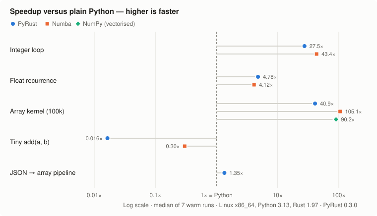

# PyRust Engine

[](https://github.com/surajmhaske02/pyrust-engine/actions/workflows/test.yml)


[](LICENSE)

**Make slow Python loops fast by adding one line.**

Put `@optimize` above a function. PyRust turns that function into Rust code, so its loops can run many times faster. You still write normal Python, and **your answers never change**: if PyRust can't run something safely, it runs your normal Python code instead.

- ✍️ **Write plain Python.** No new language and no build step.
- ⚡ **Get speed on number-crunching loops:** up to ~40× faster in our tests.
- 🛟 **Never get a wrong answer:** anything PyRust can't handle runs as normal Python.

```python
from pyrust_engine import optimize

@optimize
def weighted_sum(n: int) -> int:
    total = 0
    for i in range(n):
        if i % 7 == 0:
            total += i // 3
        else:
            total += i % 11
    return total

weighted_sum(500_000)        # first call compiles (~0.2 s), then runs natively
weighted_sum(500_000)        # ~27x faster than plain Python on our benchmark
weighted_sum.report()        # native/fallback counts, timings, fallback reasons

@optimize
def add(a, b):              # no loop: runs as plain Python, zero overhead (0.4)
    return a + b
```

> **Status: experimental prototype.** Not a general Python compiler and not production-hardened. Tests pass in CI on Linux, Windows and macOS (Python 3.10, 3.12, 3.13); published benchmarks are from Linux x86_64.

## Comparison at a glance

| | Plain Python | **PyRust 0.4** |
|---|---|---|
| Integer loop (500k) | 25.5 ms · 1× | **0.93 ms · 27.5×** |
| Float recurrence (300k) | 7.21 ms · 1× | **1.51 ms · 4.8×** |
| Array kernel (100k float64) | 5.91 ms · 1× | **0.144 ms · 40.9×** |
| Tiny `add(a, b)` per call | 0.034 µs · 1× | **≈ 0.034 µs · 1×** (runs as plain Python, new in 0.4) |
| JSON → array pipeline | 5.93 ms · 1× | **4.40 ms · 1.35×** |
| Big integers / overflow | Exact | **Exact (replays in Python)** |
| Unsupported code | Runs | **Runs in Python, reason logged** |
| Extra runtime dependencies | None | **None** (NumPy for arrays) |
| First call (compile) | None | 0.15–0.18 s (0.05 s from disk cache) |

<sub>Speed numbers are "time · speedup vs Python". Full method, raw data and caveats under [How it compares](#how-it-compares).</sub>

## Version comparison

| | 0.1.0 | 0.2.0 | 0.3.0 | **0.4.0 (current)** |
|---|---|---|---|---|
| Types | `int` | `int`, `float`, NumPy `float64` arrays | `int`, `float`, NumPy `float64` arrays | same |
| Arithmetic | `+ - *` | `+ - * // % /` | `+ - * // % /`, unary `+` | same |
| Loops | `range(stop)`, `range(start, stop)` | all `range` forms, `while`, `break`, `continue` | same | same |
| Branches | `if` / `else` | `if` / `else` | `if` / `elif` / `else` with early returns, `break`/`continue` in branches | same |
| Conditions | single comparison | single comparison, `and` / `or` / `not` | chained `a < b < c`, truthiness, float vs int literal | same |
| Final `return` required | Yes | Yes | No (missing return replays in Python) | No |
| Tiny `add(a, b)` per call | 3.3 µs (native) | 5.3 µs (native) | 2.0 µs (native) | **≈ Python speed** (loop-free functions run as plain Python) |
| Cache | per-user disk cache | hashed, cross-process locked, self-repairing | same | same |
| Tools | `report()` | + `prepare`, `reset`, metrics, profiler CLI, cache pruning | same | + `native_loop_free` option |
| Automated tests | 12 | 34 | 47 | **56** |
| CI platforms passing | — | — | Linux | **Linux, Windows, macOS** |
| Random testing | 100 rounds of fixed kernels | 12,000+ comparisons on fixed templates | + 32,000 generated-program comparisons, 0 mismatches | same |

---

## Why it exists

Most "make Python fast" tools ask you to give something up: a new interpreter, a build step, a different integer model, or a heavy dependency. PyRust takes a narrower bet:

- **Correctness first.** Integers stay arbitrary-precision. If a 64-bit operation would overflow, divide by zero, index out of bounds or hit an invalid `range` step, the native call stops and **the original Python function is replayed**, so you get exactly Python's result or Python's exception. Nothing wraps silently.
- **Opt-in, per function.** Decorate the hot loop, leave everything else alone. Unsupported code, inputs or environments run as normal Python and the reason is recorded.
- **Light footprint.** Pure-Python package with no runtime dependencies (NumPy only for array kernels). Uses `rustc` directly through `ctypes`: no PyO3, Maturin, crates or C compiler toolchain beyond Rust's own linker.

## How it compares

### Speed



| Workload | Python | **PyRust** | PyRust vs Python |
|---|---:|---:|---:|
| Integer loop (`//`, `%`, branches; n = 500k) | 25.5 ms | **0.93 ms** | **27.5× faster** |
| Float recurrence (n = 300k) | 7.21 ms | **1.51 ms** | **4.8× faster** |
| Array kernel, sum of squares (100k float64) | 5.91 ms | **0.144 ms** | **40.9× faster** |
| Tiny function `add(a, b)`, per call (0.4 default) | 0.034 µs | **≈ 0.034 µs** | **same speed** (plain Python) |
| Tiny function `add(a, b)`, forced native | 0.034 µs | 2.08 µs | 61× slower |
| JSON → NumPy → kernel → JSON pipeline | 5.93 ms | **4.40 ms** | **1.35× faster** |

<sub>Median of 7 warm runs, wrapper and argument conversion included. Loop workloads and the forced-native row were measured with 0.3.0 (the native path is unchanged in 0.4.0). In 0.4.0 the default tiny-function path is the original Python bytecode, so it costs the same as plain Python. Confirmed on a GitHub Actions `ubuntu-latest` runner: Python 0.060 µs, PyRust 0.4 0.060 µs (1.0×), forced native 3.92 µs ([`benchmarks/results-v0.4.0-ci-ubuntu.json`](benchmarks/results-v0.4.0-ci-ubuntu.json)). Linux x86_64, CPython 3.13.18, Rust 1.97.0, NumPy 2.5.4. Raw samples: [`benchmarks/results-v0.3.0.json`](benchmarks/results-v0.3.0.json). Reproduce with `python -m examples.benchmark_suite`.</sub>

**How to read this, honestly:**

- PyRust gives **large speedups on loop-heavy numeric code**: 27.5× on the integer loop and 40.9× on the array kernel.
- Gains vary by workload: the float recurrence improved 4.8×.
- **Tiny functions no longer get slower.** Loop-free functions skip native dispatch and run as plain Python (details in [Tiny functions](#tiny-functions-the-problem-and-the-fix)). A function *with* a loop but a very small input still pays about 2 µs per call.
- **End-to-end gains shrink** when parsing and conversion dominate: the JSON pipeline only improved 1.35×.

### Startup cost

| Workload | First call incl. Rust compile | First call from disk cache |
|---|---:|---:|
| Integer loop | 0.175 s | 0.047 s |
| Float recurrence | 0.183 s | 0.062 s |
| Array kernel | 0.179 s | 0.049 s |

PyRust caches compiled libraries on disk across processes. Use `fn.prepare()` (or `prepare(background=True)`) before latency-sensitive work.

### Design trade-offs

This table compares how each tool is designed. It is not a benchmark.

| | **PyRust** | Numba | Cython | PyPy | Codon |
|---|---|---|---|---|---|
| How you use it | Decorator on a function | Decorator on a function | Separate build step (`.pyx` or annotated `.py`) | Different Python interpreter | Separate compiler |
| Integer overflow | **Exact Python result** (replays in Python) | Wraps at 64 bits | Python ints exact; C-typed ints follow C rules (optional overflow checks) | Exact | Wraps at 64 bits |
| Unsupported code | Runs as normal Python, reason recorded | Compile error | Compiles via the C API (slower paths) | Runs everything | Compile error |
| Scope | Small numeric subset | Large NumPy-oriented subset | Full Python | Full Python | Large Python-like subset |
| Runtime dependencies | None (NumPy for arrays) | numba + llvmlite | None after build | Whole runtime | Codon runtime |
| Toolchain needed | `rustc` | none extra | C compiler | none extra | Codon |
| Maturity | Experimental | Mature | Mature | Mature | Active project |

**Pick PyRust** when you want Python-exact integer semantics, a silent safety net and no compiled dependency stack, and your hot spots are plain numeric loops. **Pick Numba or NumPy** for maximum speed on array maths. **Pick Cython** when you need to compile large or object-heavy code. **Pick PyPy** to speed up a whole pure-Python application.

## Tiny functions: the problem and the fix

**The problem (0.3.0 and earlier).** `add(a, b)` took 2.08 µs through PyRust against 0.034 µs in plain Python: 61× slower. The Rust code isn't the slow part. The add itself takes about a nanosecond. The cost is the trip from Python into native code on every call:

| Step per call | What happens |
|---|---|
| Wrapper checks | Code/defaults unchanged? Builtins not rebound? Library loaded? |
| Argument checks | Each argument must be an exact `int` that fits 64 bits, or an exact `float` |
| `ctypes` conversion | Python objects → C values, plus an output buffer for the result |
| Native call | Status code back, then the result is read out of the buffer |
| Metrics | Timers and counters updated under a lock |

Together that is about 2 µs. A loop of 500,000 iterations easily pays it back. A single addition never can.

**The fix (0.4.0).** At decoration time, PyRust checks the function's AST. A function with **no `for` or `while` loop** does a fixed, tiny amount of work, so native code can't win. For those functions `@optimize` returns a plain Python function (a clone of the original with `report()`, `prepare()`, `reset()` and `rust_source()` attached). There is no wrapper, so a call costs exactly what the original costs, and results are the original's by construction.

```python
@optimize
def add(a, b):
    return a + b

add(2, 3)                    # plain Python speed
add.report()['dispatch']     # 'python-direct'
add.report()['reason']       # 'loop-free function: a native call costs more than ...'

@optimize(native_loop_free=True)   # force Rust anyway (e.g. to test the native path)
def add_native(a, b):
    return a + b
```

Trade-off: a loop-free function has no wrapper, so `report()` can't count its calls (`call_counting` is `False`).

**What still costs ~2 µs.** A function that contains a loop but is called with tiny inputs (say `n = 3`), or a tiny function called millions of times from a Python loop. Best practice today: decorate the function that **contains the hot loop**, not the small function it calls. The real fixes are on the [roadmap](#roadmap): a CPython extension call path instead of `ctypes`, and inlining calls between optimized functions.

## Limitations

- **Small numeric subset.** `int` (64-bit, overflow-checked), `float`, read-only 1-D `float64` arrays. No lists, dicts, strings, classes, `**`, recursion, generators or calls to other functions. Those run as plain Python.
- **Per-call overhead of ~2 µs** for native calls. Loop-free functions avoid it (0.4.0); loops with tiny inputs don't.
- **First call compiles** (about 0.2 s per function, about 0.05 s from the disk cache). Use `fn.prepare()` ahead of time.
- **Arrays are read-only.** No array outputs or element writes; only `float64`, 1-D, C-contiguous.
- **No calls between optimized functions.** Each native call goes back through Python.
- **Needs `rustc` on `PATH`** on every machine that should run natively (no prebuilt wheels).
- **Native loops can't be interrupted** by Ctrl-C until they finish or hit `max_iterations`.
- **Benchmarks come from one Linux x86_64 machine.** CI runs the tests on Windows and macOS, but there are no published numbers for those platforms or ARM yet.
- **Experimental.** Not production-hardened, not a sandbox: only run trusted code.

## Correctness evidence

- **56 automated tests**, passing in CI on Linux, Windows and macOS with Python 3.10, 3.12 and 3.13, covering semantics, overflow replay, exceptions, NaN, ±0.0, infinities, array layouts, bounds, cache corruption and recovery, cross-process locking, background compilation, threads and profiling.
- **Generated-program fuzzing:** 4,000 random programs (2,000 integer + 2,000 float, using `while`, `break`, `continue`, `elif`, `//`, `%`, `/`), **32,000 calls compared with CPython, 0 mismatches**. Floats are compared by `repr`, so NaN and signed zero must match exactly. Every generated program must compile natively, so the test can't pass by quietly falling back to Python.
- **Fuzzer sensitivity:** deliberately planted bugs (wrong modulo sign; `a / b` rewritten as `a * (1/b)`) were caught immediately.

Details and limitations: [`VALIDATION.md`](VALIDATION.md).

## Install

Requires **Python 3.10+** and **Rust** (`rustc` on `PATH`, from <https://rustup.rs>). Not yet on PyPI.

```sh
git clone https://github.com/surajmhaske02/pyrust-engine.git
cd pyrust-engine
python -m pip install ".[arrays]"          # NumPy for array kernels
python -m unittest discover -s tests -v    # 56 tests
python -m examples.benchmark_suite         # add ".[benchmark]" for Numba comparison
```

Without Rust, everything still works in plain Python; `report()` says why.

## Usage

### Integer and float kernels

Save functions in a `.py` file (source must be inspectable). Annotations pick native types: unannotated or `int` means signed 64-bit integer; `float` means f64.

```python
from pyrust_engine import optimize

@optimize
def recurrence(n: int, value: float) -> float:
    for i in range(n):
        value = (value * 1.000001 + 0.0001) / 1.000002
    return value
```

Arguments must be exact `int` (fitting 64 bits) or exact `float`. Anything else, including `bool`, int subclasses or an int passed to a `float` parameter, runs in Python. A local variable keeps one type: start a float accumulator at `0.0`, not `0`.

### NumPy arrays without copying

```python
import numpy as np
from pyrust_engine import optimize, F64Array

@optimize
def energy(values: F64Array) -> float:
    total = 0.0
    for i in range(len(values)):
        x = float(values[i])
        total += x * x
    return total

energy(np.arange(100_000, dtype=np.float64))
```

Accepted arrays: exact `ndarray`, 1-D, C-contiguous, aligned, native-endian `float64`. Others fall back without copying. Kernels only read arrays. Use `float(values[i])` for element reads; negative indices work and out-of-bounds reads raise Python's `IndexError` via replay.

### Supported syntax

| Construct | Native support |
|---|---|
| Parameters | `int` (default), `float`, `F64Array` |
| Integer ops | `+ - *`, unary `- +`, `//` and `%` with Python floor semantics; overflow-checked |
| Float ops | `+ - * /`, unary `- +`; mixed int/float promotes like Python; no fast-math |
| Loops | `for` over `range(stop)`, `range(start, stop)`, `range(start, stop, step)` (negative steps too); `while`; `break`; `continue` |
| Branches | `if` / `elif` / `else`, early `return` |
| Conditions | Comparisons incl. chained `a < b < c`; float vs int literal (`x > 0`); `and`, `or`, `not`; truthiness `if n:` |
| Locals | Assignment, annotated assignment, `+= -= *= //= %= /=` |
| Calls | `len(array)`, `float(x)`, `float(array[i])` |

These run as normal Python instead: lists, dicts, strings, other calls, `**`, recursion, closures, generators, classes, array writes. Variables first assigned inside a loop aren't treated as assigned after it, which is conservative by design.

### Control and diagnostics

```python
fn.prepare()                    # compile now
fn.prepare(background=True)     # compile in a thread; calls use Python meanwhile
fn.reset()                      # clear compile state and retry
fn.report()                     # calls, native/fallback counts, timings, fallback_reasons
fn.rust_source()                # inspect the generated Rust
fn.python(...)                  # call the original function

@optimize(fallback=False)            # raise OptimizationError instead of falling back (good for benchmarks)
@optimize(max_iterations=10**9)      # native loop budget (default 10,000,000)
@optimize(native_loop_free=True)     # compile loop-free functions too (default: run them as plain Python)
```

> **Iteration budget:** a call that exceeds `max_iterations` discards its native work and **replays the whole call in Python**, losing the speedup. With 12M iterations: Python 0.450 s, default budget 0.384 s, `max_iterations=10**9` 0.015 s. Raise it for known large loops; watch `report()['fallback_reasons']`.

### Find candidates in existing code

```sh
python -m pyrust_engine profile path/to/script.py arg1 arg2   # runs the script once (trusted code only)
python -m pyrust_engine cache --days 30                       # list old cache entries (add --delete)
```

The profiler ranks functions in the entry script by time and reports which ones fit the native subset. It never rewrites your code.

## How it works

```
Python source ─► AST check & type inference ─► Rust source (checked i64 / f64 ops)
      ─► rustc --crate-type cdylib (cached, hashed, locked) ─► ctypes call
      ─► status 0: return native result
      ─► status ≠ 0 (overflow, ÷0, bounds, budget, no return): replay original Python
```

The supported subset has no side effects, so replaying a call is always safe. Generated Rust never contains raw user text: identifiers are mapped to internal names and only allowed AST nodes are translated.

## Safety

- Run **trusted code only**. Compiled libraries run inside your process; this is not a sandbox.
- Keep the cache private (it must be owned by you and not group/world-writable on POSIX).
- Long native loops can't be interrupted by Ctrl-C until they finish or hit the iteration budget.
- Don't mutate arrays, function code or builtins concurrently with a running call.

## Project layout

```
pyrust_engine/   compiler.py (AST → Rust), runtime.py (decorator, dispatch, metrics),
                 cache.py (disk cache, locks), profiling.py, __main__.py (CLI)
tests/           test_engine.py, test_v2.py, test_v3.py, test_v4.py, test_fuzz.py (generated programs)
examples/        benchmark_suite.py (Python / PyRust / Numba / NumPy), benchmark.py
benchmarks/      raw benchmark results (0.2.0, 0.3.0 and a 0.4.0 CI run)
docs/            benchmark chart and the script that generates it
```

Regenerate the chart after a new benchmark run:

```sh
python -m examples.benchmark_suite --output benchmarks/my-results.json
python docs/make_chart.py benchmarks/my-results.json docs/benchmark-speedup.svg
```

## What's missing for developers (v0.4)

These gaps make PyRust harder to adopt today. Contributions are welcome on any of them.

| Missing | Why it matters to a developer |
|---|---|
| **No PyPI package** | You have to `git clone` the repo; `pip install pyrust-engine` doesn't work yet. |
| **No warning when a function falls back to Python** | Your code can quietly run at Python speed and you won't know unless you call `fn.report()`. A `warn_on_fallback=True` option or a log message would make this visible. |
| **No "will this compile?" check for a single function** | The profiler checks a whole script by running it. A quick `fn.explain()` or `python -m pyrust_engine check file.py` that lists each unsupported line would save trial and error. |
| **No calls between optimized functions** | A helper function used inside a hot loop can't be compiled with it, so you have to put all the logic in one function. |
| **Common Python features unsupported** | Lists, `**`, `abs`/`min`/`max`, `math` functions and array writes all fall back to Python, which limits real-world code. |
| **Needs Rust installed on every machine** | No prebuilt binaries, so every user and server needs `rustc`. |
| **No type hints / `py.typed`** | Editors and type checkers don't know about `fn.report()`, `fn.prepare()` and the other helpers. |
| **No tutorial notebook or API reference** | There's no step-by-step notebook to try it, and the `report()` fields aren't documented in one place. |
| **No contributor guide** | No `CONTRIBUTING.md`, issue templates or formatter config, and the dense code style makes first contributions harder. |
| **No GitHub Releases or macOS/Windows benchmarks** | Tags exist but there are no release notes to read, and speed numbers only cover Linux. |

## Roadmap

What needs improving, most impactful first:

1. **Lower native call overhead (2 µs → well under 1 µs).** Replace the `ctypes` call with a small CPython extension entry point, and generate a specialised argument checker per function instead of a generic loop.
2. **Calls between optimized functions.** Inline small helpers into the caller's Rust code so `add()` inside a hot loop costs nothing.
3. **Adaptive dispatch.** Measure native vs Python time for the first calls and route small inputs (e.g. `n = 3`) to Python automatically.
4. **Array outputs and writes**, 2-D arrays, and `float32` / `int64` element types.
5. **Prebuilt wheels / PyPI release** so users don't need `rustc` for common cases.
6. **Published benchmarks for macOS (Apple Silicon), Windows and ARM Linux**, and against Cython, PyPy and Codon.
7. **Generated-program fuzzing for array kernels.**

See [`CHANGELOG.md`](CHANGELOG.md) for release history.

## License

[MIT](LICENSE) © 2026 Suraj Mhaske
